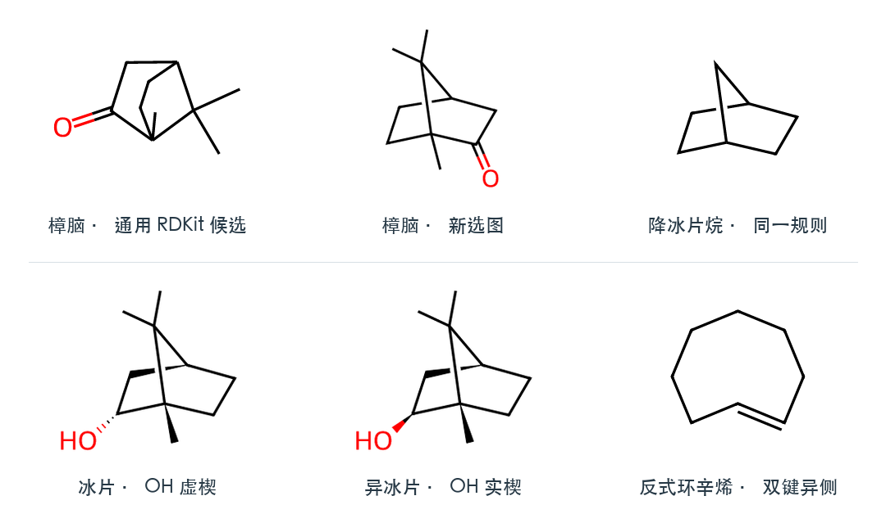

# chemcard

> Inline 2D chemical structures for AI chat explanations — an MCP App (RDKit + MCP Apps) that lets Claude or ChatGPT drop clean structure figures, reaction steps and highlights between paragraphs, like equations in a textbook.

让 AI 在讲解化学时，在文字之间插入干净、正确、紧凑的 2D 结构图：像讲义里的公式一样，而不是嵌入一个完整的化学编辑器。


> **早期实验项目（v0.4）。** 已在 Claude 桌面版中实测；ChatGPT 接入方式已按文档实现，但尚未实测。

## 能做什么

- **画分子**（`draw_molecule`）：模型给 SMILES，服务器用 RDKit 画图。键长固定，小分子画得小，大分子不会被压缩；任意双环 bicyclo[a.b.c] 按拓扑选画法：桥连的（降冰片烯、DABCO、奎宁…）从三维构象投影出带前后关系的透视图，投影不行时按桥长构造平面图，吗啡喃类（右美沙芬、吗啡、可待因、纳洛酮…）使用教科书坐标模板，画法清晰。
- **画反应步骤**（`draw_reaction_step`）：一步一张「A + B → C」，条件写在箭头上方，可逆反应用 ⇌。讲机理时一步一张，图下紧跟这一步的讲解。
- **弯箭头**：在反应物上画电子推动箭头。起点可以是孤对电子（`lp:1`）或一根键（`bond:2-3`），终点可以是原子或正在形成的键，也支持单电子的鱼钩箭头。原子用 SMILES 里的映射号指定（`[OH-:1]`），质子转移时把 H 显式写出（`[H:5]`）。
- **高亮**：用 SMARTS（`"C=O"`）或原子映射号（`[NH2:1]`）给原子和键加上彩色底色，标出正在讲的部分。
- **点选原子**：在卡片上点选原子，自动转成片段 SMILES 和带编号的 SMILES，推给模型或填入输入框；模型可以用同样的编号回过头来高亮。
- **检查机理**（`check_mechanism`，不显示卡片）：检查每个物种的价态、意外的自由基（例如 `C[N+](C)C` 漏写了 H）、不稳定的碳正离子、酸碱条件矛盾，以及每一步的原子与电荷是否守恒、前后步骤是否衔接。明显的笔误会被直接拒绝，模型收到原因后自行修正。

### 复杂分子怎么选画法



- **樟脑和降冰片烷**共用一条布局规则。找到两个桥头及其间的三条路径后，两条长路径围出轮廓，短桥抬起。程序比较前后桥头与左右路径的几种安排，优先选取代基朝外、标签清楚的视角。交叉处的短缺口标出后方的键。这套手调视角只覆盖饱和全碳 `[2.2.1]` 骨架和末端取代。
- **任意双环 bicyclo[a.b.c]** 先按拓扑识别，再决定画法（`chem/perspective.py`）。识别：一个环系的环数（圈秩）为 2，且恰有两个原子连着三条环路径。两个桥头之间的三条路径长 a ≥ b ≥ c，杂原子、环内双键和取代基都可以有。c = 0 表示桥头共用一根键（十氢萘是 [4.4.0]）。
  - **c = 0（稠合）**：两个正多边形共用桥头键，平铺，不做交叉。通用引擎本来就这样画，只有它们画得不干净时才会试这条。
  - **c ≥ 1（桥连）**：按指定的立体化学生成三维结构，从几百个方向看过去，按骨架评分（正好一处前后交叉、原子不挤、两个桥头分得开）排序。然后依次把每个视角转正，让 RDKit 排好取代基，标出后方的键，再查立体化学、直线角和全部布局缺陷，找到干净的就停；最多试 12 个视角。氯代 [2.2.2] 就是这样保住了排在第 3 的好视角：前两个视角放上 Cl 之后都有冲突。
  - **投影没有干净结果时**，直接按三条路径的长度构造平面图：两条路径用单位键长的圆弧围成外轮廓，第三条以带弓度的锯齿链从内部穿过，不留交叉。[1.1.1]、[3.3.3]、[4.4.4] 和挤的托品烷类走这条路。
  - 桥头构型由三维结构保证，后方的键是离观察者更远的那根；测试会用独立生成的构象核对。手调的 [2.2.1] 视角优先。一个分子里同类双环多于一个（利培酮的两个稠合双环）、三环以上的笼子、重原子超过 40 的分子不做这一步。

![按 [a.b.c] 选出的最终画法：氯代 [2.2.2] 的第 3 个投影视角、[1.1.1]、[3.3.3]、[4.4.4] 的构造平面图、十氢萘的共用键、[4.3.2] 的投影、奎宁、阿托品、托品酮、鱼腥藻毒素-a、地棘蛙素、桉叶油素](docs/images/bicyclo-abc.png)

- **冰片和异冰片**可以并排对照。两张卡片保留相同的骨架朝向，羟基分别使用虚楔和实楔。图中的一对为 [PubChem CID 1201518](https://pubchem.ncbi.nlm.nih.gov/compound/1201518) 和 [CID 6973640](https://pubchem.ncbi.nlm.nih.gov/compound/6973640)。
- **顺反环辛烯**先检查输入指定的双键构型。比较双键两端相连原子在二维图中位于同侧还是异侧，淘汰几何关系错误的候选，再比较可读性。

## 快速开始

需要 [uv](https://docs.astral.sh/uv/) 和 Python ≥ 3.11。

```bash
git clone <this repo> chemcard && cd chemcard
uv sync
uv run pytest
```

### 接入 Claude 桌面版（本地运行，无需部署）

在 `~/Library/Application Support/Claude/claude_desktop_config.json` 的 `mcpServers` 中加入下面的配置。`uv` 请写**绝对路径**（可用 `which uv` 查看），因为从 Dock 启动的应用读不到终端里的 PATH。

```json
"chemcard": {
  "command": "/absolute/path/to/uv",
  "args": ["--directory", "/absolute/path/to/chemcard", "run", "chemcard"]
}
```

完全退出 Claude（⌘Q）再打开，新开对话问「画出阿司匹林，标出会水解的部分」。

**想让模型主动画图？** Claude 的连接器工具是按需加载的；问题本身没有提到「画」或「结构」时，模型往往不会去加载 chemcard。建议在 设置 → 个人资料 → 个人偏好（或项目说明）里加一句：

```text
讲解化学时，只要涉及具体的分子、官能团或反应机理，就用 chemcard 连接器把结构画出来（draw_molecule / draw_reaction_step），并用高亮标出正在讲的部分。
```

### 接入 ChatGPT（需要公网 HTTPS，未实测）

```bash
CHEMCARD_ALLOWED_HOSTS=xxxx.ngrok-free.app uv run chemcard --http   # 监听 http://127.0.0.1:8000/mcp
ngrok http 8000
```

`CHEMCARD_ALLOWED_HOSTS` 用于放行隧道域名，否则 MCP SDK 的 DNS rebinding 防护会返回 `421 Invalid Host header`。然后在 ChatGPT 中选择「Add custom MCP server」，填入 `https://xxxx.ngrok-free.app/mcp`。

## 工具一览

| 工具 | 谁调用 | 作用 |
|---|---|---|
| `draw_molecule` | 模型 | 画一个分子，可带 `highlights` |
| `draw_reaction_step` | 模型 | 画一步「A + B → C」；`highlights` 用 `side` 和 `index` 指明标在哪个物种上，`arrows` 画弯箭头 |
| `check_mechanism` | 模型 | 画多步机理之前整体检查一遍，不显示卡片 |
| `render_structure_svg` | 仅卡片 | 宿主没有把图交给卡片时，卡片自己取图 |
| `render_reactant_scheme` | 仅卡片 | 同上，用于带弯箭头的反应物整图 |
| `describe_selection` | 仅卡片 | 把点选的原子转成片段 SMILES 和带编号的 SMILES |

## 已知限制

- **模型不一定会主动画图**：需要用户侧的提示，比如个人偏好、项目说明或 Skill，见上文。
- **化学检查只查账面错误**：查得出价态、守恒和前后衔接的问题，判断不了「这种条件下会不会这样反应」，也判断不了选择性。
- **弯箭头是第一版**：箭头的弯曲方向和位置由简单的打分规则自动选择，复杂的分子上可能和别的键或标签挤在一起；暂不校验箭头和产物是否对得上（计划在 v0.5）。
- **Claude 是否支持 `ui/update-model-context` 未确认**：如果不支持，点选原子后需要点「提问」，模型才知道你选了什么。
- **ChatGPT 未实测。**
- **重新打开历史对话时，chemcard 服务器需要在运行**：Claude 不把 `_meta` 交给卡片，卡片要回服务器取图。

## 踩坑记录

如果你也在做 MCP Apps，这些可能帮你省点时间（均为 2026-11 在 Claude 桌面版中观察到的现象）：

- **Claude 会丢掉工具参数结构里的 `$ref`**：嵌套的模型字段会变成 `items: {}`，模型看不到这些字段，自然也不会填。解决办法是注册工具后把参数结构展开（见 `server.flatten_schema`），并让每个工具的嵌套深度不超过一个已确认能完整显示的工具。
- **Claude 不把工具结果里的 `_meta` 交给卡片**：卡片拿不到 SVG，就会显示为空白。解决办法是提供一个只给卡片调用的工具（`visibility: ["app"]`），让卡片通过 `tools/call` 自己取图。
- **卡片向宿主报告高度 0 会导致空白卡片**：内容出现之前不要发送 `size-changed`。
- **RDKit 的自适应画布（`MolDraw2DSVG(-1, -1)`）会忽略 `fixedBondLength`**：先画一遍测出实际键长，再按比例缩放坐标后重画。
- **布局引擎各有长处**。CoordGen 画普通分子和大环最干净，却会把托品酮、可卡因的 N-甲基画进环里；RDKit 的环系模板能避开这个问题。候选在通过几何检查后按交叉、原子间距、压键、取代基位置、估算的标签间距和键长均匀度比较，只有明显更好时才放弃 CoordGen。其中「取代基落进环里」是后加的一项：只看交叉和重叠时，托品酮的两种画法都不扣分，结果会选回画坏的那种；桥环里的桥原子落在别的环内是正常画法，所以只统计不在环上的原子。清晰的专用桥环视角享有优先级。
- **吗啡喃有惯用画法**。这类骨架优先采用参考坐标，右美沙芬和吗啡本身保留参考图中完整的取代基坐标。
- **单独的 `[H+]`** 在 CoordGen 下可能得到 NaN 坐标，布局器会尝试其他候选。
- **RDKit 的 SVG 声明编码为 `iso-8859-1`**：图例里的中文会变成乱码，所以图注改放在 HTML 里。
- **RDKit 会把 `C[N+](C)C` 当成自由基阳离子，而不会报错**：如果要防住模型漏写 H，需要自己加规则检查。
- **模型每次调用后立刻读到的返回文字，比工具描述更能左右它的行为**：「先讲这一步，再画下一步」这句提醒，写在返回文字里比写在描述里有效得多。

## 架构

```
src/chemcard/
  chem/            ① 纯化学核心：不 import mcp，可单独测试
    bridged_layout.py [2.2.1] 桥环的拓扑视角和交叉留白
    perspective.py    任意 bicyclo[a.b.c]：拓扑识别；桥连的三维投影透视或构造平面图，稠合的平铺
    render.py         SMILES → SVG，分子式，标准化 SMILES，原子坐标
    highlight.py      高亮解析（SMARTS / 原子映射号 → 标准原子序号）与选区描述
    reaction.py       反应步骤的原子与电荷守恒检查
    lint.py           化学规则检查
    mechanism.py      整条机理检查（规则检查 + 守恒 + 前后衔接）
    scheme.py         带弯箭头的反应物整图：解析箭头、排布分子、计算箭头几何
    templates/        难画骨架的教科书 2D 坐标（吗啡喃、4,5-环氧吗啡喃）
  server.py        ② MCP 适配层：注册工具和资源、组装返回值，不做化学计算
  descriptions.py     模型读到的所有文字（工具描述、服务器说明、调用后的提醒）
  widgets/card.html ③ 卡片：原生 HTML/CSS/JS，只负责显示，不解析化学
benchmarks/        布局基准集（231 个样例、230 个独立化合物，来自 PubChem）与最新报告
tests/             pytest（100+ 个用例）
evals/             触发评测：哪些问题应该画图、图文是否穿插，以及实测记录
scripts/mock_host.py  本地模拟宿主
```

工具返回值分三部分，各自给不同的读者：

| 字段 | 谁能看到 | 放什么 |
|---|---|---|
| `content` | 模型和卡片（不支持 UI 的客户端只显示它） | 一句文字说明，以及给模型的提醒 |
| `structuredContent` | 模型和卡片 | 精简信息：标准化 SMILES、分子式、图注、高亮 |
| `_meta` | 只有卡片 | SVG 本体和原子坐标，不占用模型上下文 |

## 开发

```bash
uv run pytest                        # 运行测试
uv run python scripts/mock_host.py   # 本地预览：http://127.0.0.1:8765/
uv run python scripts/layout_benchmark.py /tmp/chemcard-layouts   # 候选得分、淘汰原因和每张卡的最终 SVG
uv run python scripts/layout_report.py   # 布局质量报告：坐标层面的问题 + 最终 SVG 里的标签重叠（见 benchmarks/）
```

本地预览是一个模拟聊天页：不用接入 Claude 或 ChatGPT，就能在自己电脑上看卡片效果、切换亮/暗主题、试点选原子。

## 路线

| 版本 | 内容 |
|---|---|
| v0.1 ✓ | 单分子卡片 |
| v0.2 ✓ | 反应步骤卡片，以及机理检查（`check_mechanism`） |
| v0.3 ✓ | 高亮；点选原子回传给模型 |
| v0.4 ✓ | 弯箭头：在反应物上叠加电子推动箭头，用原子映射号指定起点和终点 |
| v0.5 | 电子推动校验：按箭头推算产物，并与给出的产物比对 |

## 致谢与许可

本项目使用 [MIT 许可证](LICENSE)。

- [RDKit](https://www.rdkit.org/)（BSD-3-Clause）：所有化学解析和绘图。
- [PubChem](https://pubchem.ncbi.nlm.nih.gov/)：`chem/templates/` 中的骨架坐标取自 PubChem 的 2D 结构（右美沙芬 CID 5360696、吗啡 CID 5288826）。
- [MCP Python SDK](https://github.com/modelcontextprotocol/python-sdk) 与 [MCP Apps 规范](https://github.com/modelcontextprotocol/ext-apps)。
- 思路参考（没有复制任何代码）：[ChemCP](https://github.com/scottmreed/ChemCP)、[chemdraw-mcp](https://github.com/jurimaxam-dotcom/chemdraw-mcp)、[ChemKit](https://github.com/Oli-CodeHub/ChemKit)，以及 OpenAI 的 [Apps SDK 示例](https://github.com/openai/openai-apps-sdk-examples)。

本项目与 RDKit、Anthropic、OpenAI、Revvity（ChemDraw）均无关联。
